<div align="center">

<!-- Header Banner -->


<p align="center">
  
  
  
  
  
</p>

<p align="center">
  <a href="#-system-overview">Overview</a> •
  <a href="#-core-oop-principles-implemented">OOP Principles</a> •
  <a href="#-role-based-access-control-rbac">Access Control</a> •
  <a href="#-system-architecture--workflow">Architecture</a> •
  <a href="#-package-structure--class-design">Package Design</a> •
  <a href="#-data-persistence-engine">Data Persistence</a> •
  <a href="#-getting-started">Getting Started</a>
</p>

</div>

---

### 📖 System Overview

The **Enterprise Library Management System (LMS)** is a robust, modular desktop circulation and inventory platform architected in **Core Java**. Designed with a strict focus on **software engineering patterns and object-oriented principles**, the system automates library administrative workflows across student registration, cataloging, inventory auditing, and borrowing transactions.

The system features a **Multi-Tier Role-Based Access Control (RBAC)** security layer that grants distinct privileges to **Administrators**, **Librarians**, and **Students/Patrons**. Data persistence is managed via an optimized file stream I/O engine, ensuring ACID-like durability, transaction logging, and zero data loss across execution sessions without external database dependencies.

---

### 🌟 Core OOP Principles Implemented

- **Interface Segregation & Abstraction:** Complete decoupling of operations through dedicated interfaces (`Ibook`, `IBookOperations`, `IBorrowOperations`, `ILibrarianOperations`, and `IStudentOperations`). Callers interact solely with contracts, isolating business logic from representation.
- **Inheritance & Reusability:** The base class `Common` centralizes shared entity attributes (ID, Name, Email, Contact Number, Address) inherited cleanly by specialized domain classes (`Student`, `Librarian`).
- **Encapsulation:** All class attributes use strict `private` visibility with validated getters and setters to protect internal state.
- **Object Composition:** The `Book` entity aggregates distinct `Author` and `Publisher` domain models, reflecting real-world compositional associations.
- **Polymorphism & Dynamic Dispatch:** Operations implement polymorphic method overriding for customized entity displays, search routines, and transaction auditing.

---

### 🔐 Role-Based Access Control (RBAC)

The application enforces a 3-tier operational security model with dedicated authentication portals:

| Portal Role | Default Username | Default Password | Granted Permissions & Operational Capabilities |
| :--- | :--- | :--- | :--- |
| **🛡️ Administrator** | `admin` | `1234` | Full librarian staff lifecycle management: Provision new librarians, search librarian by ID, list all active staff, and revoke/delete staff records. |
| **📚 Librarian** | `librarian` | `1234` | **Student Management:** Register new students, search student records by Library ID, view patron directory, remove student accounts.<br>**Inventory Management:** Catalog new books with Author & Publisher metadata, search catalog by Book ID, list inventory. |
| **🎓 Student / Patron** | `student` | `1234` | Self-service circulation portal: Search and browse library catalog, initiate book checkout/borrow transactions, and process book returns. |

---

### 🧠 System Architecture & Workflow

```mermaid
flowchart TD
    A["User Authentication Gateway (Start.java)"] --> B{"Role Credential Verification"}
    
    B -->|"admin / 1234"| C["Admin Portal"]
    B -->|"librarian / 1234"| D["Librarian Portal"]
    B -->|"student / 1234"| E["Student Portal"]
    
    subgraph AdminOps ["Administrator Operations"]
        C --> C1["ILibrarianOperations: insertLibrarian()"]
        C --> C2["ILibrarianOperations: getLibrarian(id)"]
        C --> C3["ILibrarianOperations: showAllLibrarians()"]
        C --> C4["ILibrarianOperations: removeLibrarian(id)"]
    end
    
    subgraph LibOps ["Librarian Operations"]
        D --> D1["IStudentOperations: insertStudent()"]
        D --> D2["IStudentOperations: getStudent(id)"]
        D --> D3["IStudentOperations: showAllStudents()"]
        D --> D4["IStudentOperations: removeStudent(id)"]
        D --> D5["IBookOperations: insertBook()"]
        D --> D6["IBookOperations: getBook(id)"]
        D --> D7["IBookOperations: showAllBooks()"]
    end
    
    subgraph StudOps ["Student Operations"]
        E --> E1["IBookOperations: showAllBooks()"]
        E --> E2["IBookOperations: getBook(id)"]
        E --> E3["IBorrowOperations: borrowAbook()"]
        E --> E4["IBorrowOperations: returnbook()"]
    end
    
    subgraph Storage ["Persistent File I/O Engine"]
        F1[("LIBRARIAN_DATA.txt")]
        F2[("STUDENT_DATA.txt")]
        F3[("BOOK_Data.txt")]
        F4[("BORROW_RECORDINGS.txt")]
    end
    
    AdminOps <--> F1
    LibOps <--> F2 & F3
    StudOps <--> F3 & F4
```



---

### 📦 Package Structure & Class Design

```
├── interfaces/
│   ├── Ibook.java                  # Contract specification for Book entities
│   ├── IBookOperations.java        # Interface for catalog insertion, search, and display
│   ├── IBorrowOperations.java      # Interface for checkout and return transactions
│   ├── ILibrarianOperations.java   # Interface for staff administration
│   └── IStudentOperations.java     # Interface for student patron lifecycle
├── common/
│   └── Common.java                 # Abstract/Base entity providing shared contact and ID fields
├── author/
│   └── Author.java                 # Author domain model (ID, Name, Email)
├── publisher/
│   └── Publisher.java              # Publisher domain model (ID, Name, Contact)
├── book/
│   └── Book.java                   # Core Book entity composed of Author and Publisher
├── bookoperations/
│   └── BookOperations.java         # Implementation of book storage, lookup, and printing
├── student/
│   └── Student.java                # Student patron model (extends Common, guardian metadata)
├── studentoperations/
│   └── StudentOperations.java      # Implementation of student registration and directory lookup
├── librarian/
│   └── Librarian.java              # Staff librarian model (extends Common, salary, role)
├── librarianoperations/
│   └── LibrarianOperations.java    # Implementation of librarian persistence and querying
├── borrowoperations/
│   ├── Borrow.java                 # Borrow transaction data transfer model
│   └── BorrowOperations.java       # Borrowing logic, issue dates, and return records
├── Start.java                      # Main CLI driver, RBAC authentication loop & exception handler
├── LICENSE                         # Open-source MIT License
└── README.md                       # Comprehensive system documentation
```

---

### 💾 Data Persistence Engine

The platform implements persistent flat-file data storage requiring zero external database configuration:

- **`BOOK_Data.txt`**: Catalog inventory store preserving Book ID, Title, Author metadata, Publisher contacts, and Unit Price.
- **`STUDENT_DATA.txt`**: Patron registry tracking Library ID, Student ID, Department, Contact info, and Guardian emergency numbers.
- **`LIBRARIAN_DATA.txt`**: Staff repository recording Librarian ID, Name, Email, and Authorization status.
- **`BORROW_RECORDINGS.txt`**: Audit trail maintaining active loans, borrower identifiers, transaction timestamps, and return settlement records.

---

### 🚀 Getting Started

#### Prerequisites
- **Java Development Kit (JDK 8 or higher)**: [Oracle JDK](https://www.oracle.com/java/technologies/downloads/) or [Eclipse Temurin](https://adoptium.net/)
- Ensure `javac` and `java` are available in your system path:
  ```bash
  javac -version
  java -version
  ```

#### 1. Clone the Repository
```bash
git clone https://github.com/ReaduanulFaridFahim/Libray-Managment-System-RFF-WRT.git
cd Libray-Managment-System-RFF-WRT
```

#### 2. Unpack Project Source Tree
If running from the bundled archive, extract `Lms.zip` to expose the package structure:
```bash
# Windows (PowerShell)
Expand-Archive -Path Lms.zip -DestinationPath ./temp_extract
Copy-Item -Path "./temp_extract/LIBRARY MANAGEMENT SYSTEM(G-05)/*" -Destination ./ -Recurse -Force
Remove-Item -Path ./temp_extract -Recurse -Force

# Linux / macOS
unzip Lms.zip -d temp_extract
cp -r temp_extract/"LIBRARY MANAGEMENT SYSTEM(G-05)"/* ./
rm -rf temp_extract
```

#### 3. Compile the Application
Compile all packages and the main driver class:
```bash
javac -d bin Start.java interfaces/*.java common/*.java author/*.java publisher/*.java book/*.java bookoperations/*.java student/*.java studentoperations/*.java librarian/*.java librarianoperations/*.java borrowoperations/*.java
```

Or compile in-place:
```bash
javac Start.java
```

#### 4. Run the System
```bash
java Start
```

---

### 🛡️ Exception Handling & Input Sanitization

- **Scanner Input Protection:** All numeric and menu choices are wrapped inside robust `try-catch` blocks intercepting `InputMismatchException` to prevent runtime JVM crashes on invalid input.
- **Buffer Flushing:** Stream buffer cleanups (`in.nextLine()`) eliminate stray newline characters during alternating integer-to-string terminal reads.
- **Graceful Termination:** Menu hierarchies include safe unwind states returning patrons to parent portals without terminating the background process.

---

### 👥 Authors & Academic Context

Developed as an Object-Oriented Programming (OOP) term project by **Readuanul Farid Fahim** (RFF) and research group colleagues (Group-05).

- **Lead Developer:** [Readuanul Farid Fahim](https://github.com/ReaduanulFaridFahim)
- **Portfolio:** [https://readuanulfaridfahim.github.io/](https://readuanulfaridfahim.github.io/)

---

<div align="center">


</div>
